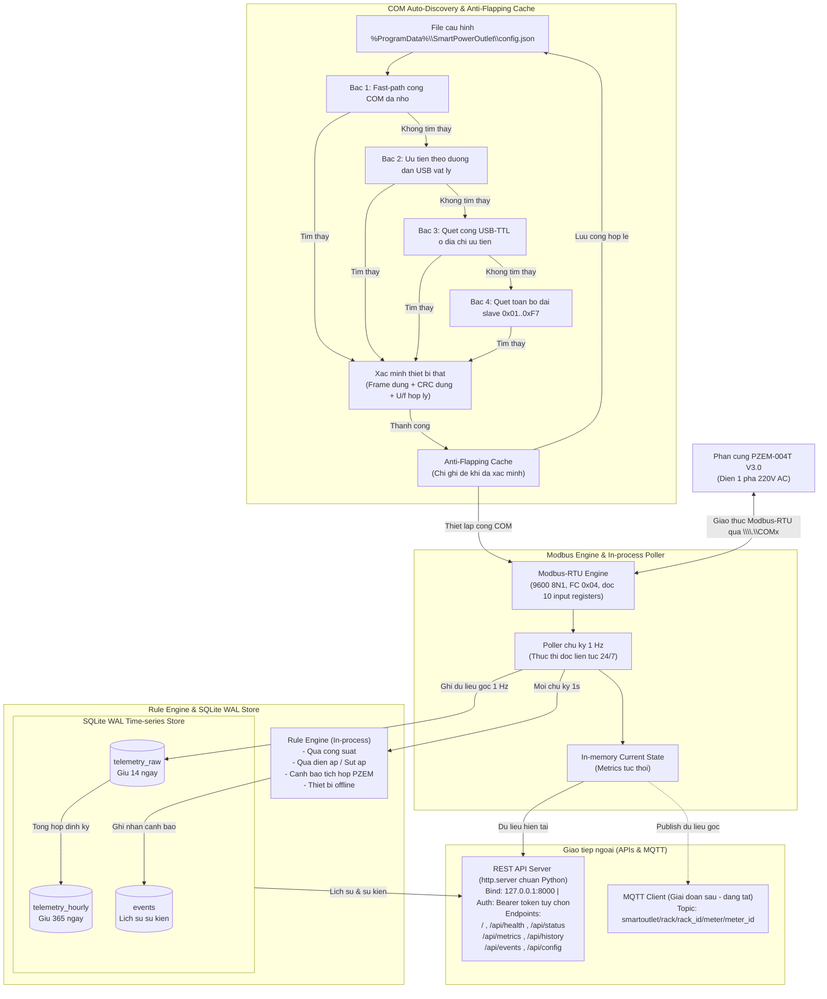
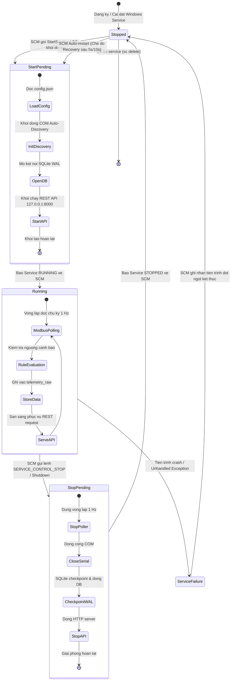

# Kiến trúc nội bộ Electronic PC Agent

Tài liệu này mô tả chi tiết các thành phần bên trong, luồng xử lý và vòng đời hoạt động của **Electronic PC Agent** (chạy dưới dạng Windows Service `SmartPowerOutletAgent` hoặc Linux systemd daemon `smart-power-agent.service`).

---

## 1. Sơ đồ luồng xử lý nội bộ (Mermaid Flowchart)

---

## 2. Vòng đời Windows Service (Mermaid stateDiagram-v2)

Dịch vụ chạy dưới tên định danh `SmartPowerOutletAgent` (tên hiển thị: "Smart Power Outlet PC Agent") với cơ chế tự động phục hồi bởi Service Control Manager (SCM).

---

## 3. Bảng luồng dữ liệu (Data Flows)

| Nguồn | Đích | Giao thức | Tần suất |
| :--- | :--- | :--- | :--- |
| **PZEM-004T V3.0** | **Modbus-RTU Engine** | Modbus-RTU qua serial `\\.\COMx` (9600 baud, 8N1, Function Code 0x04, đọc 10 input registers) | 1 Hz (1 lần mỗi giây) |
| **COM Auto-Discovery** | **Anti-Flapping Cache** | Ghi đè file JSON cục bộ (`%ProgramData%\SmartPowerOutlet\config.json`) | Khi khởi động hoặc khi cổng COM thay đổi và đã xác minh thành công thiết bị thật |
| **Modbus-RTU Engine** | **In-memory Current State** | Bộ nhớ nội bộ tiến trình (in-process memory update) | 1 Hz (ngay sau khi nhận frame Modbus hợp lệ) |
| **Poller** | **Rule Engine (In-process)** | Hàm gọi nội bộ (in-memory function call) | 1 Hz (sau mỗi lần đọc dữ liệu mới) |
| **Poller** | **Bảng `telemetry_raw` (SQLite WAL)** | SQLite INSERT (Chế độ WAL mode) | 1 Hz (lưu trữ đầy đủ dữ liệu trong 14 ngày) |
| **Bộ tổng hợp (Aggregator)** | **Bảng `telemetry_hourly` (SQLite WAL)** | SQLite INSERT / SELECT aggregate | 1 giờ / lần (lưu trữ dữ liệu trung bình trong 365 ngày) |
| **Rule Engine** | **Bảng `events` (SQLite WAL)** | SQLite INSERT | Tức thời khi phát hiện vượt ngưỡng hoặc thiết bị offline |
| **Bên ngoài (Dashboard / Web / Client)** | **REST API (`http.server`)** | HTTP / JSON tại `127.0.0.1:8000` (Hỗ trợ Bearer Token tùy chọn) | Bất đồng bộ theo yêu cầu (on-demand polling từ UI / scripts) |
| **In-memory Current State** | **MQTT Broker** *(Giai đoạn sau)* | MQTT (Topic `smartoutlet/rack/<rack_id>/meter/<meter_id>`) | 1 Hz hoặc theo sự kiện *(Hiện tại đang tắt)* |
