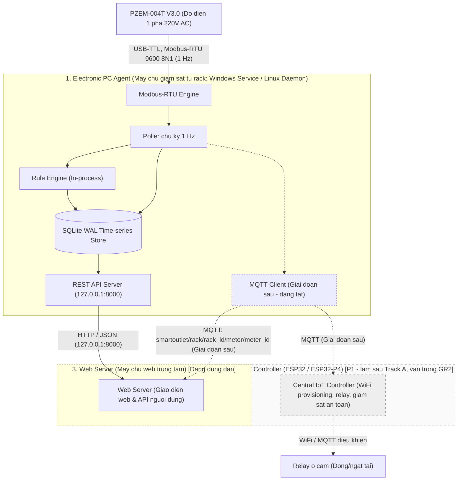

# Kiến trúc tổng thể hệ thống Smart Power Outlet

Tài liệu này mô tả kiến trúc tổng thể 3 thành phần của hệ thống Smart Power Outlet theo đặc tả thiết kế hệ thống.

---

## 1. Sơ đồ kiến trúc tổng thể (Mermaid Flowchart)



---

## 2. Sơ đồ ASCII (Bản in đen trắng, chiều rộng <= 100 ký tự)

```text
+===============================================================================================+
  KIEN TRUC TONG THE HE THONG SMART POWER OUTLET - 3 THANH PHAN
+===============================================================================================+

  [ PZEM-004T V3.0 ]   Dong ho do dien 1 pha 220V AC
         |
         |  USB-TTL - Modbus-RTU 9600 8N1 - FC 0x04 - 10 input register - 1 Hz
         v

+-----------------------------------------------------------------------------------------------+
| 1. ELECTRONIC PC AGENT - may chu giam sat trong tu rack                                       |
| Windows Service: SmartPowerOutletAgent (Smart Power Outlet PC Agent)                          |
| Linux systemd unit: smart-power-agent.service                                                 |
| Chay 24/7, headless, tu khoi dong cung OS, KHONG can dang nhap nguoi dung                     |
| Modbus-RTU Engine 9600 8N1 (FC 0x04) - doc 10 input register moi giay                         |
| COM Auto-Discovery 4 bac + Anti-Flapping Cache (chi ghi de khi da xac minh)                   |
| SQLite WAL: telemetry_raw 14 ngay | telemetry_hourly 365 ngay | events                        |
| Rule Engine in-process: qua cong suat, qua ap, sut ap, alarm PZEM, offline                    |
| REST API 127.0.0.1:8000 + dashboard tinh web/index.html                                       |
| MQTT Client (giai doan sau - dang tat)                                                        |
|     topic: smartoutlet/rack/<rack_id>/meter/<meter_id>                                        |
+-----------------------------------------------------------------------------------------------+

         |  REST / JSON  127.0.0.1:8000            :  MQTT (giai doan sau)
         v                                            v

  +------------------------------------------+   +----------------------------------------------+
   3. WEB SERVER - may chu web trung tam     |    2. CENTRAL IOT CONTROLLER - ESP32 / ESP32-P4  |
                                             |                                                  |
   - Phuc vu giao dien web + API nguoi dung  |    - WiFi provisioning + duy tri ket noi         |
   - Doc du lieu qua REST/MQTT tu PC Agent   |    - MQTT subscriber nhan lenh dieu khien        |
   - KHONG cam truc tiep cong serial         |    - Dieu khien relay + giam sat an toan         |
                                             |                                                  |
   Trang thai: dang dung dan                 |    Trang thai: P1 - lam sau Track A          |
                                             |      (van thuoc pham vi GR2)                 |
  +------------------------------------------+   +----------------------------------------------+

                                                   :
                                                   :  WiFi / MQTT
                                                   v
                                                         [ RELAY O CAM ]
                                                      (Dong / ngat tai nguon)

+===============================================================================================+
```

---

## 3. Bảng ranh giới trách nhiệm

| Thành phần | Chạy trên | Trách nhiệm | Giao tiếp |
| :--- | :--- | :--- | :--- |
| **1. Electronic PC Agent** | Máy chủ giám sát trong tủ rack (Windows Server: Service `SmartPowerOutletAgent` hoặc Linux host: `smart-power-agent.service`) | Chạy 24/7 headless, tự khởi động cùng OS không cần user login; tự dò tìm cổng COM (4 bậc); đọc dữ liệu cảm biến đo điện (1 Hz); đánh giá Rule Engine tức thời; lưu trữ chuỗi thời gian SQLite WAL; cung cấp REST API nội bộ và dashboard tĩnh. | - **Nhận**: Modbus-RTU 9600 8N1 qua USB-TTL (`\\.\COMx`)<br/>- **Cung cấp**: REST API tại `127.0.0.1:8000`<br/>- **Gửi (tương lai)**: MQTT publisher |
| **2. Central IoT Controller** *(Trạng thái: P1 - làm sau Track A, vẫn trong GR2)* | Vi điều khiển ESP32 / ESP32-P4 (Firmware Arduino & ESP-IDF) | Là bộ điều khiển IoT trung tâm; cấu hình & duy trì kết nối WiFi (provisioning); subscriber nhận lệnh MQTT; điều khiển đóng/ngắt relay ổ cắm; giám sát an toàn (quá nhiệt, quá tải cắt relay). | - **Nhận**: MQTT subscriber qua WiFi<br/>- **Điều khiển**: GPIO tới relay ổ cắm |
| **3. Web Server** *(Trạng thái: Đang dựng dần)* | Máy chủ web trung tâm (Linux host hoặc cùng host rack) | Phục vụ giao diện web người dùng và API trung tâm; hiển thị dữ liệu đo đạc, báo cáo, lịch sử sự kiện. | - **Nhận**: REST API / MQTT từ PC Agent (tuyệt đối không cắm cổng serial trực tiếp) |

---

## 4. Ghi chú bắt buộc về kiến trúc

1. **Lý do Web Server không cắm trực tiếp cổng serial:**
   - Hệ điều hành (đặc biệt là Windows) quản lý cổng COM theo cơ chế độc quyền (exclusive lock) — tại một thời điểm chỉ có duy nhất một tiến trình được phép mở và giữ handle cổng serial.
   - Electronic PC Agent là tiến trình duy nhất chạy nền 24/7 (dưới dạng Windows Service / systemd daemon), chịu trách nhiệm duy trì kết nối serial và thu thập dữ liệu chu kỳ 1 Hz.
   - Nếu Web Server cố gắng mở trực tiếp cổng COM sẽ gây xung đột tài nguyên (`Access Denied` / `Port Busy`) làm gián đoạn việc giám sát liên tục. Do đó, Web Server chỉ nhận dữ liệu thông qua REST API hoặc MQTT từ PC Agent.

2. **Ranh giới trách nhiệm giữa các thành phần:**
   - PC Agent và Web Server là hai thực thể logic độc lập với ranh giới trách nhiệm rõ ràng, không được gộp chung thành một khối duy nhất.
   - PC Agent chuyên trách tầng thiết bị (Edge / Device Layer): thu thập Modbus thời gian thực, lưu trữ cục bộ SQLite và phục vụ API nội bộ.
   - Web Server chuyên trách tầng trình diễn và người dùng (Application / User Layer): quản lý người dùng, giao diện quản trị tập trung và tích hợp hệ thống.
